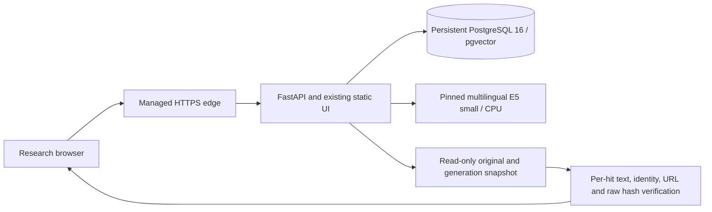

# Architecture and evidence boundaries

The diagram describes the selected deployment architecture. Cloud infrastructure has not been provisioned. Local integration uses an isolated TLS-enabled PostgreSQL container, a read-only application role and the production application image; it does not substitute for external cloud verification.

The public app has one origin, one application process and shared initialization. `/live` reports process liveness; `/health` remains unavailable until database binding, complete archive validation, model loading, warmup and final binding checks pass. The existing 60-second initialization deadline is retained. The production entrypoint also verifies the entire manifest-bound release, including model files, before serving requests.

Search uses the original semantic query, ranker v2 lexical/provision candidates, pgvector and reciprocal-rank fusion. Published generation JSONL and originals are copied byte-for-byte. Runtime verifies returned text, document/chunk identity, official URL, source digest and active generation/model/ranker binding. A changed binding invalidates readiness. Raw files and models are read-only in the production image; no arbitrary file or URL inspection endpoint is added.

Database migration exports only the two protected generations, their document/chunk/index metadata, required content-hash/model-revision embeddings and three release-state keys. The export transaction is repeatable-read and read-only. Restore refuses the source endpoint and any target with existing public tables, then imports and verifies complete digests in one transaction. It never drops a database/table. Other local historical generations, policy records, review decisions and user observations remain local and are outside this deployment snapshot.

The public image exposes neither Ollama management nor the private Passport service, synchronization or candidate workers. Public AI activation is blocked independently of configuration/certification files. Evidence is data; it cannot modify host allowlists, deployment settings, instructions or schedules. The existing Qwen selector and backend quotation/citation controls remain available only through the original private development workflow.
